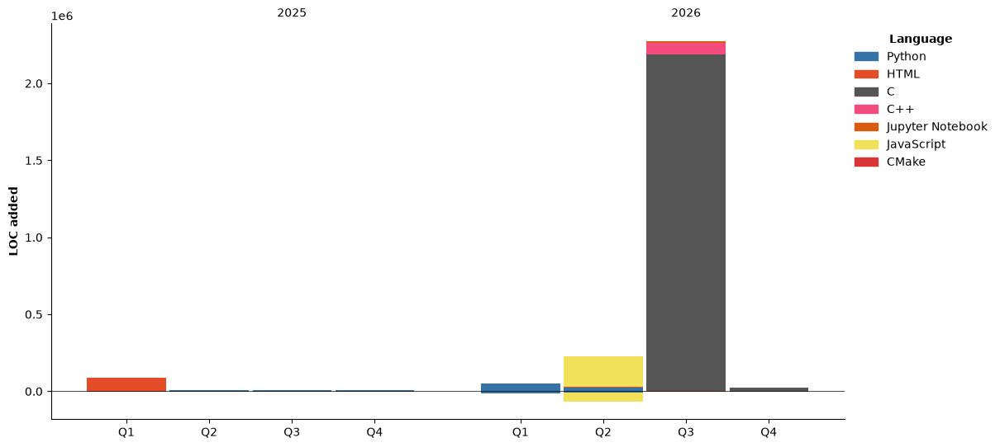

# Stats


-----------------------------------

<!--START_SECTION:activity-->
1. 🗣 Commented on [#128](https://github.com/antirez/kilo/pull/128#issuecomment-6896103688) in [antirez/kilo](https://github.com/antirez/kilo)
2. ❌ Closed PR [#1](https://github.com/MXD-K1/MXD-K1/pull/1) in [MXD-K1/MXD-K1](https://github.com/MXD-K1/MXD-K1)
<!--END_SECTION:activity-->

<!--START_SECTION:waka-->


**🐱 My GitHub Data** 

> 📦 218.3 kB Used in GitHub's Storage 
 > 
> 🏆 334 Contributions in the Year 2026
 > 
> 💼 Opted to Hire
 > 
> 📜 11 Public Repositories 
 > 
> 🔑 21 Private Repositories 
 > 
**I'm an Early 🐤** 

```text
🌞 Morning                1452 commits        ████████░░░░░░░░░░░░░░░░░   31.11 % 
🌆 Daytime                1068 commits        ██████░░░░░░░░░░░░░░░░░░░   22.88 % 
🌃 Evening                1896 commits        ██████████░░░░░░░░░░░░░░░   40.63 % 
🌙 Night                  251 commits         █░░░░░░░░░░░░░░░░░░░░░░░░   05.38 % 
```
📅 **I'm Most Productive on Thursday** 

```text
Monday                   418 commits         ██░░░░░░░░░░░░░░░░░░░░░░░   08.96 % 
Tuesday                  575 commits         ███░░░░░░░░░░░░░░░░░░░░░░   12.32 % 
Wednesday                578 commits         ███░░░░░░░░░░░░░░░░░░░░░░   12.38 % 
Thursday                 999 commits         █████░░░░░░░░░░░░░░░░░░░░   21.41 % 
Friday                   682 commits         ████░░░░░░░░░░░░░░░░░░░░░   14.61 % 
Saturday                 875 commits         █████░░░░░░░░░░░░░░░░░░░░   18.75 % 
Sunday                   540 commits         ███░░░░░░░░░░░░░░░░░░░░░░   11.57 % 
```


📊 **This Week I Spent My Time On** 

```text
🕑︎ Time Zone: Asia/Aden

💬 Programming Languages: 
C                        11 hrs 55 mins      ███████████████░░░░░░░░░░   59.06 % 
C/C++                    3 hrs 29 mins       ████░░░░░░░░░░░░░░░░░░░░░   17.29 % 
Makefile                 2 hrs 29 mins       ███░░░░░░░░░░░░░░░░░░░░░░   12.36 % 
C/C                      1 hr 1 min          █░░░░░░░░░░░░░░░░░░░░░░░░   05.08 % 
Markdown                 31 mins             █░░░░░░░░░░░░░░░░░░░░░░░░   02.62 % 

🔥 Editors: 
CLion                    19 hrs 48 mins      █████████████████████████   98.04 % 
WebStorm                 17 mins             ░░░░░░░░░░░░░░░░░░░░░░░░░   01.41 % 
VS Code                  5 mins              ░░░░░░░░░░░░░░░░░░░░░░░░░   00.44 % 
PyCharm                  1 min               ░░░░░░░░░░░░░░░░░░░░░░░░░   00.11 % 
```

🤖 **AI Coding This Week** 

```text
⏱ AI Coding Time: 20 mins (1.73%)

✍️ 0 lines written by AI, 1,385 lines written by hand (0.0% AI-written)

🔤 17,825 Input Tokens, 3,307 Output Tokens

💵 $0.02 Estimated AI Cost This Week

🧠 2 AI Sessions, 9 AI Prompts

GPT                      0 lines             ░░░░░░░░░░░░░░░░░░░░░░░░░   00.00 % 

🔎 AI Coding Insights:
🧑‍💻 Mostly Hands-On — 0.0% of written lines came from AI
📝 Concise Prompter — average 76 characters per prompt
🔁 Iterative Prompter — average 4 prompts per session
🔍 Hands-On Reviewer — 100.0% of changed lines were hand-edited
```

**I Mostly Code in C** 

```text
C                        13 repos            █████████░░░░░░░░░░░░░░░░   36.11 % 
Python                   12 repos            ████████░░░░░░░░░░░░░░░░░   33.33 % 
C++                      1 repo              █░░░░░░░░░░░░░░░░░░░░░░░░   02.78 % 
Shell                    1 repo              █░░░░░░░░░░░░░░░░░░░░░░░░   02.78 % 
Jupyter Notebook         1 repo              █░░░░░░░░░░░░░░░░░░░░░░░░   02.78 % 
```


**Timeline**




 Last Updated on 15/11/2026 13:47:50 UTC
<!--END_SECTION:waka-->

-----------------------------------

[](https://user-badge.committers.top/yemen_public/MXD-K1)

[](https://www.codewars.com/users/MXD-K1)


