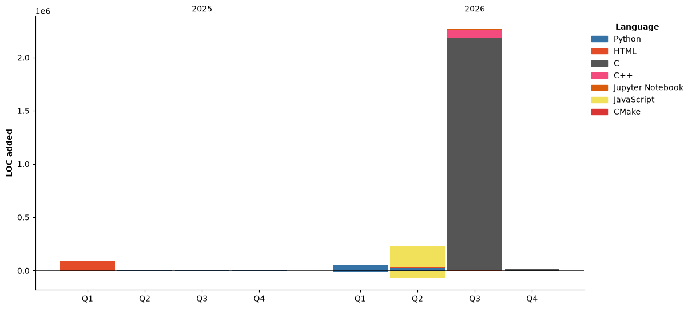

# Stats


-----------------------------------

<!--START_SECTION:activity-->
1. ❌ Closed PR [#1](https://github.com/MXD-K1/MXD-K1/pull/1) in [MXD-K1/MXD-K1](https://github.com/MXD-K1/MXD-K1)
2. 💪 Opened PR [#1](https://github.com/MXD-K1/MXD-K1/pull/1) in [MXD-K1/MXD-K1](https://github.com/MXD-K1/MXD-K1)
<!--END_SECTION:activity-->

<!--START_SECTION:waka-->


**🐱 My GitHub Data** 

> 📦 218.2 kB Used in GitHub's Storage 
 > 
> 🏆 325 Contributions in the Year 2026
 > 
> 💼 Opted to Hire
 > 
> 📜 11 Public Repositories 
 > 
> 🔑 19 Private Repositories 
 > 
**I'm an Early 🐤** 

```text
🌞 Morning                1447 commits        ████████░░░░░░░░░░░░░░░░░   31.17 % 
🌆 Daytime                1057 commits        ██████░░░░░░░░░░░░░░░░░░░   22.77 % 
🌃 Evening                1888 commits        ██████████░░░░░░░░░░░░░░░   40.66 % 
🌙 Night                  251 commits         █░░░░░░░░░░░░░░░░░░░░░░░░   05.41 % 
```
📅 **I'm Most Productive on Thursday** 

```text
Monday                   420 commits         ██░░░░░░░░░░░░░░░░░░░░░░░   09.05 % 
Tuesday                  571 commits         ███░░░░░░░░░░░░░░░░░░░░░░   12.30 % 
Wednesday                578 commits         ███░░░░░░░░░░░░░░░░░░░░░░   12.45 % 
Thursday                 996 commits         █████░░░░░░░░░░░░░░░░░░░░   21.45 % 
Friday                   679 commits         ████░░░░░░░░░░░░░░░░░░░░░   14.62 % 
Saturday                 860 commits         █████░░░░░░░░░░░░░░░░░░░░   18.52 % 
Sunday                   539 commits         ███░░░░░░░░░░░░░░░░░░░░░░   11.61 % 
```


📊 **This Week I Spent My Time On** 

```text
🕑︎ Time Zone: Asia/Aden

💬 Programming Languages: 
C                        10 hrs 30 mins      █████████████░░░░░░░░░░░░   50.29 % 
C/C++                    2 hrs 10 mins       ███░░░░░░░░░░░░░░░░░░░░░░   10.42 % 
Makefile                 2 hrs 5 mins        ██░░░░░░░░░░░░░░░░░░░░░░░   10.00 % 
Other                    1 hr 56 mins        ██░░░░░░░░░░░░░░░░░░░░░░░   09.26 % 
C/C                      1 hr 1 min          █░░░░░░░░░░░░░░░░░░░░░░░░   04.93 % 

🔥 Editors: 
CLion                    19 hrs 24 mins      ███████████████████████░░   92.82 % 
PyCharm                  47 mins             █░░░░░░░░░░░░░░░░░░░░░░░░   03.76 % 
Visual Studio            40 mins             █░░░░░░░░░░░░░░░░░░░░░░░░   03.23 % 
IntelliJ IDEA            2 mins              ░░░░░░░░░░░░░░░░░░░░░░░░░   00.19 % 
```

🤖 **AI Coding This Week** 

```text
⏱ AI Coding Time: 2 hrs 48 mins (13.41%)

✍️ 800 lines written by AI, 4,889 lines written by hand (14.06% AI-written)

🔤 559,396 Input Tokens, 127,273 Output Tokens

💵 $0.80 Estimated AI Cost This Week

🧠 2 AI Sessions, 58 AI Prompts

GPT                      800 lines           █████████████████████████   100.00 % 

🔎 AI Coding Insights:
🧑‍💻 Mostly Hands-On — 14.06% of written lines came from AI
📝 Concise Prompter — average 98 characters per prompt
🔁 Iterative Prompter — average 29 prompts per session
🔍 Hands-On Reviewer — 86.92% of changed lines were hand-edited
```

**I Mostly Code in C** 

```text
C                        12 repos            █████████░░░░░░░░░░░░░░░░   34.29 % 
Python                   12 repos            █████████░░░░░░░░░░░░░░░░   34.29 % 
C++                      1 repo              █░░░░░░░░░░░░░░░░░░░░░░░░   02.86 % 
Shell                    1 repo              █░░░░░░░░░░░░░░░░░░░░░░░░   02.86 % 
Jupyter Notebook         1 repo              █░░░░░░░░░░░░░░░░░░░░░░░░   02.86 % 
```


**Timeline**




 Last Updated on 06/11/2026 14:04:32 UTC
<!--END_SECTION:waka-->

-----------------------------------

[](https://user-badge.committers.top/yemen_public/MXD-K1)

[](https://www.codewars.com/users/MXD-K1)


